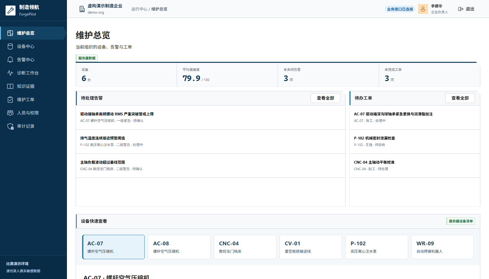
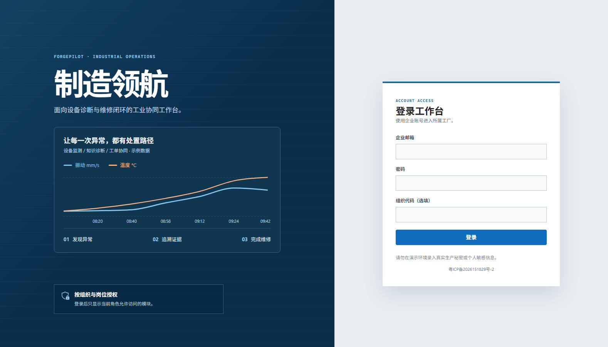
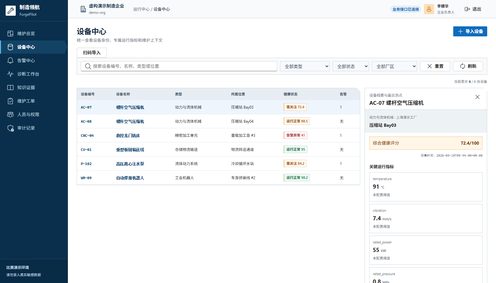
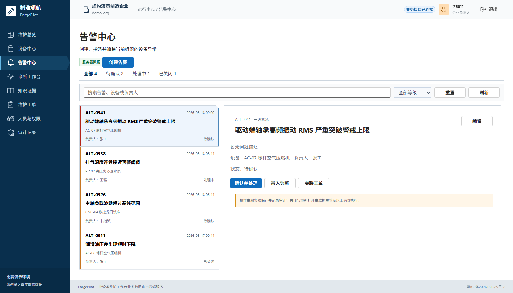
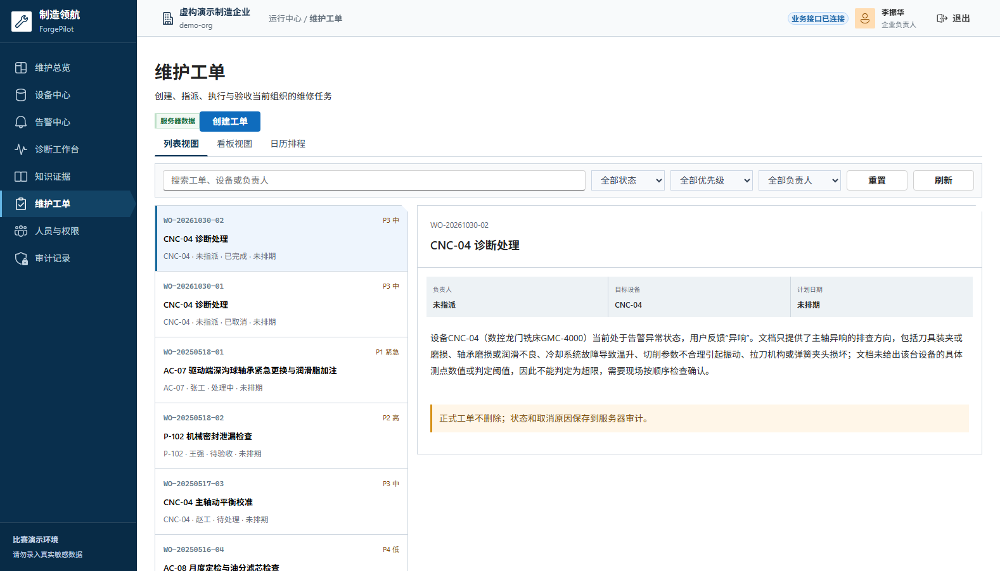
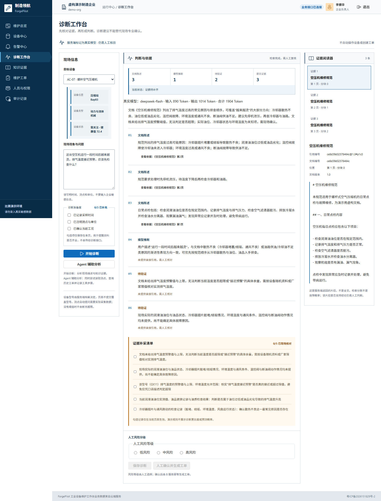
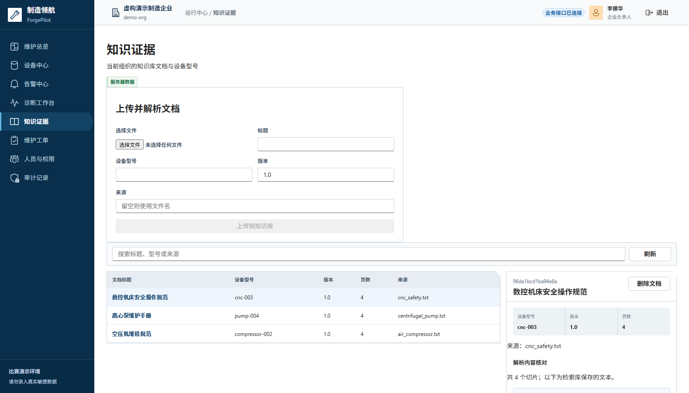
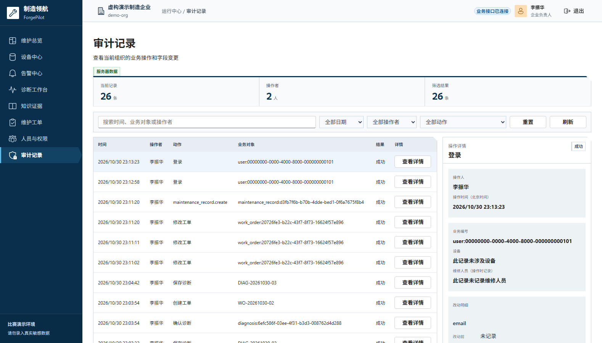
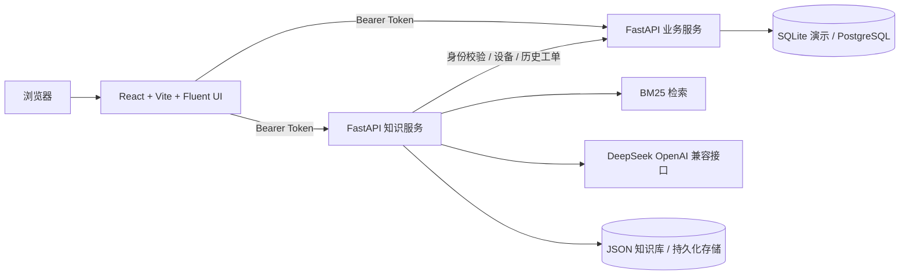

# 制造领航 ForgePilot

**面向中小制造企业的设备维护 AI 工作台**：把设备台账、测点、告警、说明书知识、AI 辅助诊断、人工确认、维修工单和审计记录串成一条可追溯的闭环。

[](https://forgepilot.xiaotianworks.cn/)
[](https://github.com/lxiaotian685-web/forgepilot-ai/actions/workflows/frontend-ci.yml)
[](https://github.com/lxiaotian685-web/forgepilot-ai/actions/workflows/backend-ci.yml)
[](LICENSE)
[](https://b23.tv/4HPzoyw)

> 第九届传智杯 AI WEB 网页开发挑战赛参赛作品。仓库使用**虚构演示数据**；在线演示接入服务端真实 DeepSeek，诊断结论仍需人工核验，不代表企业真实诊断结论。



## 立即体验

**<https://forgepilot.xiaotianworks.cn/>**

| 项目 | 值 |
|---|---|
| 演示账号 | `demo@example.com` |
| 密码 | `ForgePilot123!` |
| 组织代码 | 选填，留空即可 |
| 在线能力 | 真实登录、真实 DeepSeek 诊断、诊断保存、人工确认生成工单、审计查询 |

在线演示由 CloudBase 静态托管提供前端，CloudBase 云托管运行 `services/business` 与 `services/knowledge` 两个 FastAPI 服务，不依赖任何个人电脑。云端容器内的 SQLite 与知识库 JSON 属于演示数据，重新部署或实例重启后会恢复初始状态；长期保存请按 [CloudBase 部署说明](docs/CLOUDBASE_DEPLOY.md) 接入持久化数据库与存储。

## 界面预览

| 登录 | 设备中心 |
|---|---|
|  |  |

| 告警中心 | 维护工单 |
|---|---|
|  |  |

### 诊断工作台：把“模型回答”拆成可核对的三类内容



界面会同时展示 **文档陈述、模型推断、待验证项**，右侧是可点击核对的证据原文；顶部显示真实模型名称和输入/输出/合计 Token 用量。只有通过证据校验且非模拟的诊断才允许保存，之后由人确认生成工单。

| 知识证据 | 审计记录 |
|---|---|
|  |  |

人员与权限、更多细节见 [docs/screenshots](docs/screenshots)。

## 解决什么问题

设备出异常时，运行信息、说明书和维修任务通常分散在三个地方：现场人员靠经验判断，查资料靠翻 PDF，处理结果靠口头或表格传递。ForgePilot 把这些环节放在一个工作台里，让每一次异常都有：

```
发现异常 → 检索证据 → AI 辅助诊断 → 人工确认 → 生成工单 → 维修验收 → 审计追溯
```

首条验收路线固定为演示设备 **AC-07 螺杆空气压缩机**。

## 核心能力

| 模块 | 能力 |
|---|---|
| 维护总览 | 设备健康度、未关闭告警、未完成工单、最近诊断，按当前组织实时汇总 |
| 设备中心 | 设备档案、专属测点与趋势、类型/状态/厂区筛选、CSV 导入、扫码录入、历史维修记录 |
| 告警中心 | 待确认/处理中/已关闭页签，严重程度与负责人筛选，指派、处理、重新打开 |
| 诊断工作台 | 现场描述 + RAG 证据 + DeepSeek 诊断；事实/推断/待验证分区、证据阅读器、Token 用量、Agent 辅助分析 |
| 知识证据 | 虚构说明书上传、解析文本预览、删除、组织隔离、检索结果与引用原文 |
| 维护工单 | 列表/看板/日历三视图，设备与负责人指派、优先级、计划时间、步骤勾选、提交验收、退回、完成、取消 |
| 人员与权限 | 成员搜索、岗位/班组/状态筛选、改岗、停用前工单转派、按岗位限制导航与操作 |
| 审计记录 | 操作人、时间、对象、前后变更，按业务编号追溯诊断与建单 |

## AI 方案

**检索增强 + 结构化输出 + 人工在环**，不是让模型直接替人下结论。

1. **检索**：说明书解析后进入 BM25 文本检索，按设备型号与组织隔离，返回带来源的原文片段。
2. **生成**：通过 OpenAI 兼容适配器调用 DeepSeek（默认 `deepseek-flash`），要求结构化输出而不是一段自由文本。
3. **校验**：引用必须能在检索结果中找到；无效引用会整体降级，并明确标注“证据不足”，不会保留一个看似完整的答案。
4. **分流**：结果拆为 `文档陈述 / 模型推断 / 待验证项`，分别对应“资料写了什么”“模型怎么判断”“还需要现场确认什么”。
5. **人工确认**：模型只给建议；风险分级、保存诊断、生成工单都由人触发，重复确认返回同一张工单。
6. **可观测**：响应返回模型名、调用模式、输入/输出/合计 Token，写入诊断记录并展示在页面。
7. **受控 Agent**：`POST /api/v1/agent/assist` 只执行白名单只读工具（设备查询、同设备历史工单、证据诊断），逐步返回状态，并把工具名/状态写入审计；不操作设备、不自动建单。

模型密钥只存在知识服务端，不进入前端 `VITE_` 变量；无合法密钥时服务返回带 `is_mock` 标记的演示结果，前端不会把它当作可保存的真实诊断。

## 技术架构



| 目录 | 技术 | 职责 |
|---|---|---|
| `frontend/` | React、Vite、Fluent UI、Recharts | 设备、告警、诊断、知识、工单、人员、审计页面 |
| `services/business/` | FastAPI、SQLAlchemy、Alembic | 登录、组织与岗位权限、设备、测点、告警、工单、诊断保存、审计 |
| `services/knowledge/` | FastAPI、BM25、OpenAI 兼容适配器 | 说明书解析检索、证据引用、结构化诊断、受控 Agent |
| `docs/` | 文档与截图 | 部署、数据库、截图、Linux 运行说明 |

## 快速开始

### 本地完整演示（Windows）

需要 **Python 3.10+**、**Node.js 20+**（含 npm）和 **PowerShell 7.4+**：

```powershell
.\scripts\quickstart.ps1
```

首次运行会建立两个 Python 虚拟环境、安装依赖并启动三个服务，然后打开 `http://127.0.0.1:5180/forgepilot/`。演示账号同上；停止服务运行 `.\scripts\stop-demo.ps1`。

本地默认使用 `mock` 模型，不需要任何密钥。要接真实 DeepSeek：

```powershell
# 先设置用户环境变量 DEEPSEEK_API_KEY，再启动
.\scripts\start-demo.ps1 -DeepSeek
```

模型密钥只传入知识服务，默认 `deepseek-flash`。Linux/macOS 三终端命令见 [docs/RUN_LINUX.md](docs/RUN_LINUX.md)。

### 云端部署

前端由 CloudBase 静态托管，业务与知识服务由 CloudBase 云托管运行。完整步骤、环境变量和持久化注意事项见 [docs/CLOUDBASE_DEPLOY.md](docs/CLOUDBASE_DEPLOY.md)。

## 测试与质量

```powershell
# 前端
cd frontend; npm test; npm run build; cd ..

# 业务服务
cd services/business; .\.venv\Scripts\python.exe -m pytest -q; .\.venv\Scripts\python.exe -m ruff check .; cd ../..

# 知识服务
cd services/knowledge; .\.venv\Scripts\python.exe -m pytest -q; .\.venv\Scripts\python.exe -m ruff check .; cd ../..
```

三套测试、前端生产构建和 Ruff 均在 GitHub Actions 中执行，当前 `main` 的两项 CI 均为通过状态。知识服务的虚构数据集检索、引用与失败路径评测见 [真实 RAG 验证报告](services/knowledge/docs/real-rag-report.md)。

## 数据与安全边界

- 设备、告警、工单、说明书均为**虚构演示数据**，未使用未授权的企业原始资料。
- 组织与用户身份由登录令牌在服务端解析，不信任客户端伪造的请求头。
- 模型密钥只存在服务端；仓库只提交 `.env.example`。
- Agent 只使用白名单只读工具；诊断保存、人工确认、工单生成都必须由人触发。
- 不具备真实企业数据时，不宣称诊断结果等同于企业现场结论。

## 团队

| 成员 | 分工 |
|---|---|
| 梁晓添 | 产品、前端、业务集成、云端部署、最终统筹 |
| 林同学 | 业务后端早期开发；演示视频录制 |
| 龚同学 | 知识检索、诊断服务与文档上传 |
| 丁老师 | 业务指导（不参与代码与分工） |

A/B/C 功能分支与各轮 Pull Request 保留了细粒度开发历史；来源记录见 [docs/SOURCE_COMMITS.md](docs/SOURCE_COMMITS.md)，协作要求见 [CONTRIBUTING.md](CONTRIBUTING.md)。

## 提交材料

- 代码仓库：<https://github.com/lxiaotian685-web/forgepilot-ai>
- 在线演示：<https://forgepilot.xiaotianworks.cn/>
- 技术 PDF：[ForgePilot 技术说明（16 页）](docs/tech-report/ForgePilot_技术说明_20261031.pdf)
- 技术 PDF 源文件：[HTML 版](docs/tech-report/ForgePilot_技术说明_20261031.html)
- GitHub Release：[v1.0.0 竞赛提交版本](https://github.com/lxiaotian685-web/forgepilot-ai/releases/tag/v1.0.0)（附技术 PDF 下载）
- 5–8 分钟普通话 1080p 演示视频：[B 站 · 制造领航 ForgePilot](https://b23.tv/4HPzoyw)
- 校赛公告：[东莞理工学院计算机学院校赛公告](https://cs.dgut.edu.cn/info/1034/19118.htm)
- 社交预览图：[docs/social-preview.png](docs/social-preview.png)（在仓库 Settings → Social preview 上传）

代码使用 [MIT License](LICENSE)。虚构说明书仅用于演示，请勿上传未获授权的企业资料、密钥或个人信息。
