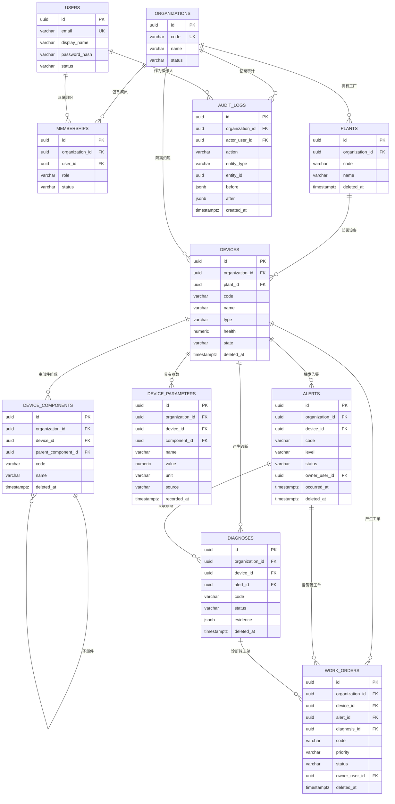

# ForgePilot 数据模型：ER 图与字段字典

> 任务包 B ｜ Issue #1 ｜ 分支 `task/issue-1-er-model`
> 迁移实现见 `migrations/versions/0001_initial.py`；接口契约见 `docs/api-contracts/business-api.yaml`。

## 1. 通用约定

- 表名、列名 `snake_case`，表名复数；主键统一 `id uuid`（由应用生成，Postgres 可选用 `gen_random_uuid()`）。
- **组织隔离**：所有业务表带 `organization_id uuid NOT NULL`（`organizations.id`），查询一律按当前登录组织过滤。
- **审计字段**（业务表）：`created_at`、`updated_at`（`timestamptz NOT NULL DEFAULT now()`）、`created_by`、`updated_by`（`uuid`，FK → `users.id`，`ON DELETE SET NULL`）。
- **软删除**：`deleted_at timestamptz NULL`。未删除为 `NULL`；删除只写时间戳。列表/详情查询必须附加 `deleted_at IS NULL`。
- **唯一约束与软删除**：业务编码唯一约束均为 `UNIQUE (organization_id, code) WHERE deleted_at IS NULL` 的分区唯一索引，删除后可复用编码。
- **数据来源与采集时间**：测量类数据必须带 `source`（来源）与 `recorded_at`（采集/生效时间）；参数值另带 `unit`（单位）。
- **模型推断不可作权威值**：`source = 'model_inference'` 时 `is_authoritative` 必须为 `false`。

## 2. 枚举

| 名称 | 值 |
|---|---|
| 组织状态 | `active`, `disabled` |
| 用户状态 | `active`, `disabled` |
| 成员角色 `role` | `owner`, `admin`, `manager`, `technician`, `viewer` |
| 成员状态 | `invited`, `active`, `disabled` |
| 设备状态 `state` | `running`, `attention`, `alert`, `offline` |
| 参数来源 `source` | `nameplate`, `manual`, `sensor`, `imported`, `model_inference`, `corrected` |
| 告警级别 `level` | `p1`, `p2`, `p3` |
| 告警状态 `status` | `pending`, `processing`, `acknowledged`, `closed` |
| 工单优先级 `priority` | `p1`, `p2`, `p3`, `p4` |
| 工单状态 `status` | `pending`, `processing`, `verifying`, `completed`, `cancelled` |
| 诊断状态 | `draft`, `confirmed`, `rejected` |
| 风险等级 | `low`, `medium`, `high` |
| 数据来源（告警/诊断） | `sensor`, `manual`, `model_inference` |

## 3. ER 图

## 4. 字段字典

### 4.1 organizations（组织 / 租户）

| 列名 | 类型 | 约束 | 说明 |
|---|---|---|---|
| `id` | `uuid` | PK | 主键 |
| `code` | `varchar(64)` | NOT NULL, UNIQUE | 组织代码 |
| `name` | `varchar(200)` | NOT NULL | 组织名称 |
| `status` | `varchar(20)` | NOT NULL, CHECK | `active` / `disabled` |
| `created_at` | `timestamptz` | NOT NULL, DEFAULT now() | 创建时间 |
| `updated_at` | `timestamptz` | NOT NULL, DEFAULT now() | 更新时间 |

### 4.2 users（用户）

| 列名 | 类型 | 约束 | 说明 |
|---|---|---|---|
| `id` | `uuid` | PK | 主键 |
| `email` | `varchar(255)` | NOT NULL, UNIQUE | 登录邮箱 |
| `display_name` | `varchar(100)` | NOT NULL | 显示名 |
| `password_hash` | `varchar(255)` | NOT NULL | 密码哈希 |
| `status` | `varchar(20)` | NOT NULL, CHECK | `active` / `disabled` |
| `last_login_at` | `timestamptz` | NULL | 最近登录 |
| `created_at` / `updated_at` | `timestamptz` | NOT NULL | 审计列 |

### 4.3 memberships（用户 ↔ 组织，RBAC）

| 列名 | 类型 | 约束 | 说明 |
|---|---|---|---|
| `id` | `uuid` | PK | 主键 |
| `organization_id` | `uuid` | NOT NULL, FK → `organizations.id` ON DELETE CASCADE | 组织隔离键 |
| `user_id` | `uuid` | NOT NULL, FK → `users.id` ON DELETE CASCADE | 用户 |
| `role` | `varchar(20)` | NOT NULL, CHECK | `owner`/`admin`/`manager`/`technician`/`viewer` |
| `status` | `varchar(20)` | NOT NULL, CHECK | `invited`/`active`/`disabled` |
| `created_at` / `updated_at` | `timestamptz` | NOT NULL | 审计列 |

约束：`UNIQUE (organization_id, user_id)`。

### 4.4 plants（工厂）

| 列名 | 类型 | 约束 | 说明 |
|---|---|---|---|
| `id` | `uuid` | PK | 主键 |
| `organization_id` | `uuid` | NOT NULL, FK → `organizations.id` ON DELETE RESTRICT | 组织隔离键 |
| `code` | `varchar(64)` | NOT NULL | 工厂代码 |
| `name` | `varchar(200)` | NOT NULL | 工厂名称 |
| `location` | `varchar(255)` | NULL | 位置 |
| `status` | `varchar(20)` | NOT NULL, CHECK | `active` / `archived` |
| `deleted_at` | `timestamptz` | NULL | 软删除时间 |
| 审计字段 | | | `created_at`/`updated_at`/`created_by`/`updated_by` |

约束：`UNIQUE (organization_id, code) WHERE deleted_at IS NULL`。

### 4.5 devices（设备）

| 列名 | 类型 | 约束 | 说明 |
|---|---|---|---|
| `id` | `uuid` | PK | 主键 |
| `organization_id` | `uuid` | NOT NULL, FK → `organizations.id` ON DELETE RESTRICT | 组织隔离键 |
| `plant_id` | `uuid` | NULL, FK → `plants.id` ON DELETE SET NULL | 所属工厂 |
| `code` | `varchar(64)` | NOT NULL | 设备编号（对外 `device_id`） |
| `name` | `varchar(200)` | NOT NULL | 设备名称 |
| `type` | `varchar(120)` | NULL | 设备类型 |
| `model` | `varchar(120)` | NULL | 型号 |
| `serial_number` | `varchar(120)` | NULL | 序列号 |
| `location` | `varchar(255)` | NULL | 安装位置 |
| `health` | `numeric(5,2)` | NOT NULL, DEFAULT 100, CHECK 0–100 | 健康度 |
| `state` | `varchar(20)` | NOT NULL, CHECK | `running`/`attention`/`alert`/`offline` |
| `deleted_at` | `timestamptz` | NULL | 软删除时间 |
| 审计字段 | | | `created_at`/`updated_at`/`created_by`/`updated_by` |

约束：`UNIQUE (organization_id, code) WHERE deleted_at IS NULL`；索引 `(organization_id, state)`、`(plant_id)`。

### 4.6 device_components（设备部件）

| 列名 | 类型 | 约束 | 说明 |
|---|---|---|---|
| `id` | `uuid` | PK | 主键 |
| `organization_id` | `uuid` | NOT NULL, FK → `organizations.id` ON DELETE RESTRICT | 组织隔离键 |
| `device_id` | `uuid` | NOT NULL, FK → `devices.id` ON DELETE CASCADE | 所属设备 |
| `parent_component_id` | `uuid` | NULL, FK → `device_components.id` ON DELETE CASCADE | 上级部件（自引用） |
| `code` | `varchar(64)` | NOT NULL | 部件编号 |
| `name` | `varchar(200)` | NOT NULL | 部件名称 |
| `position` | `varchar(120)` | NULL | 安装位置 |
| `status` | `varchar(20)` | NOT NULL, CHECK | `active` / `archived` |
| `deleted_at` | `timestamptz` | NULL | 软删除时间 |
| 审计字段 | | | 四列 |

约束：`UNIQUE (device_id, code) WHERE deleted_at IS NULL`。

### 4.7 device_parameters（设备参数）

| 列名 | 类型 | 约束 | 说明 |
|---|---|---|---|
| `id` | `uuid` | PK | 主键 |
| `organization_id` | `uuid` | NOT NULL, FK → `organizations.id` ON DELETE RESTRICT | 组织隔离键 |
| `device_id` | `uuid` | NOT NULL, FK → `devices.id` ON DELETE CASCADE | 所属设备 |
| `component_id` | `uuid` | NULL, FK → `device_components.id` ON DELETE SET NULL | 所属部件 |
| `name` | `varchar(120)` | NOT NULL | 参数名（如 `vibration`、`temperature`） |
| `value` | `numeric(18,6)` | NOT NULL | 参数值 |
| `unit` | `varchar(32)` | NULL | **单位**（如 `mm/s`、`°C`） |
| `source` | `varchar(20)` | NOT NULL, CHECK | **数据来源**：`nameplate`/`manual`/`sensor`/`imported`/`model_inference`/`corrected` |
| `source_ref` | `varchar(255)` | NULL | 来源引用（文档+页码 / 传感器点号 / 工单号） |
| `is_authoritative` | `boolean` | NOT NULL, DEFAULT false | 是否权威值 |
| `recorded_at` | `timestamptz` | NOT NULL | **采集/生效时间** |
| `deleted_at` | `timestamptz` | NULL | 软删除时间 |
| 审计字段 | | | 四列 |

约束：
- `UNIQUE (device_id, name, recorded_at) WHERE deleted_at IS NULL`
- `CHECK (source <> 'model_inference' OR is_authoritative = false)`
- 索引 `(device_id, name, recorded_at DESC)`（取最新值/趋势）

### 4.8 alerts（告警）

| 列名 | 类型 | 约束 | 说明 |
|---|---|---|---|
| `id` | `uuid` | PK | 主键 |
| `organization_id` | `uuid` | NOT NULL, FK → `organizations.id` ON DELETE RESTRICT | 组织隔离键 |
| `device_id` | `uuid` | NOT NULL, FK → `devices.id` ON DELETE CASCADE | 关联设备 |
| `code` | `varchar(64)` | NOT NULL | 告警编号（对外 `alert_id`） |
| `level` | `varchar(20)` | NOT NULL, CHECK | `p1`/`p2`/`p3` |
| `title` | `varchar(255)` | NOT NULL | 告警标题 |
| `description` | `text` | NULL | 详细描述 |
| `status` | `varchar(20)` | NOT NULL, DEFAULT `pending`, CHECK | `pending`/`processing`/`acknowledged`/`closed` |
| `owner_user_id` | `uuid` | NULL, FK → `users.id` ON DELETE SET NULL | 处理人 |
| `source` | `varchar(20)` | NOT NULL, DEFAULT `sensor`, CHECK | 告警数据来源 |
| `occurred_at` | `timestamptz` | NOT NULL | 告警发生时间（采集时间） |
| `acknowledged_at` | `timestamptz` | NULL | 确认时间 |
| `acknowledged_by` | `uuid` | NULL, FK → `users.id` ON DELETE SET NULL | 确认人 |
| `deleted_at` | `timestamptz` | NULL | 软删除时间 |
| 审计字段 | | | 四列 |

约束：`UNIQUE (organization_id, code) WHERE deleted_at IS NULL`；索引 `(organization_id, status)`、`(device_id)`。

### 4.9 diagnoses（诊断）

| 列名 | 类型 | 约束 | 说明 |
|---|---|---|---|
| `id` | `uuid` | PK | 主键 |
| `organization_id` | `uuid` | NOT NULL, FK → `organizations.id` ON DELETE RESTRICT | 组织隔离键 |
| `device_id` | `uuid` | NOT NULL, FK → `devices.id` ON DELETE CASCADE | 关联设备 |
| `alert_id` | `uuid` | NULL, FK → `alerts.id` ON DELETE SET NULL | 关联告警 |
| `code` | `varchar(64)` | NOT NULL | 诊断编号 |
| `question` | `text` | NULL | 用户问题 |
| `conclusion` | `text` | NULL | 诊断结论 |
| `risk_level` | `varchar(20)` | NOT NULL, CHECK | `low`/`medium`/`high` |
| `confidence` | `numeric(5,2)` | NULL | 置信度 |
| `evidence` | `jsonb` | NULL | 证据（文档/版本/页码/片段/分数） |
| `status` | `varchar(20)` | NOT NULL, DEFAULT `draft`, CHECK | `draft`/`confirmed`/`rejected` |
| `deleted_at` | `timestamptz` | NULL | 软删除时间 |
| 审计字段 | | | 四列 |

约束：`UNIQUE (organization_id, code) WHERE deleted_at IS NULL`。

### 4.10 work_orders（维护工单）

| 列名 | 类型 | 约束 | 说明 |
|---|---|---|---|
| `id` | `uuid` | PK | 主键 |
| `organization_id` | `uuid` | NOT NULL, FK → `organizations.id` ON DELETE RESTRICT | 组织隔离键 |
| `device_id` | `uuid` | NOT NULL, FK → `devices.id` ON DELETE RESTRICT | 目标设备 |
| `alert_id` | `uuid` | NULL, FK → `alerts.id` ON DELETE SET NULL | 来源告警 |
| `diagnosis_id` | `uuid` | NULL, FK → `diagnoses.id` ON DELETE SET NULL | 来源诊断 |
| `code` | `varchar(64)` | NOT NULL | 工单号（对外 `work_order_id`） |
| `title` | `varchar(255)` | NOT NULL | 标题 |
| `description` | `text` | NULL | 描述 |
| `priority` | `varchar(10)` | NOT NULL, DEFAULT `p3`, CHECK | `p1`/`p2`/`p3`/`p4` |
| `status` | `varchar(20)` | NOT NULL, DEFAULT `pending`, CHECK | `pending`/`processing`/`verifying`/`completed`/`cancelled` |
| `owner_user_id` | `uuid` | NULL, FK → `users.id` ON DELETE SET NULL | 负责人 |
| `due_at` | `timestamptz` | NULL | 计划完成 |
| `started_at` | `timestamptz` | NULL | 开始时间 |
| `closed_at` | `timestamptz` | NULL | 关闭时间 |
| `deleted_at` | `timestamptz` | NULL | 软删除时间 |
| 审计字段 | | | 四列 |

约束：`UNIQUE (organization_id, code) WHERE deleted_at IS NULL`；索引 `(organization_id, status)`、`(device_id)`、`(owner_user_id)`。

状态流转：`pending → processing → verifying → completed`；`pending/processing → cancelled`；`verifying → processing`（返工）。其余流转拒绝。

### 4.11 audit_logs（审计日志）

| 列名 | 类型 | 约束 | 说明 |
|---|---|---|---|
| `id` | `uuid` | PK | 主键 |
| `organization_id` | `uuid` | NOT NULL, FK → `organizations.id` ON DELETE RESTRICT | 组织隔离键 |
| `actor_user_id` | `uuid` | NULL, FK → `users.id` ON DELETE SET NULL | 操作人 |
| `action` | `varchar(64)` | NOT NULL | 动作，如 `device.read`、`alert.acknowledge`、`work_order.create` |
| `entity_type` | `varchar(64)` | NOT NULL | 实体类型 |
| `entity_id` | `uuid` | NULL | 实体主键 |
| `before` | `jsonb` | NULL | 变更前快照 |
| `after` | `jsonb` | NULL | 变更后快照 |
| `ip` | `varchar(64)` | NULL | 来源 IP |
| `created_at` | `timestamptz` | NOT NULL, DEFAULT now() | 记录时间（只追加，不更新） |

索引：`(organization_id, created_at DESC)`、`(entity_type, entity_id)`。

## 5. 隔离与软删除规则

- 所有业务查询必须同时满足 `organization_id = :current_org AND deleted_at IS NULL`；跨组织访问一律返回 `404`，不泄露存在性。
- 软删除只允许通过仓储/服务层写入 `deleted_at`，禁止物理删除业务数据。
- `audit_logs` 不做软删除，只追加；组织删除时因 `RESTRICT` 被阻止，需先归档。
- 唯一约束使用分区唯一索引，删除后编码可复用；应用层仍需在写入前做友好校验。
