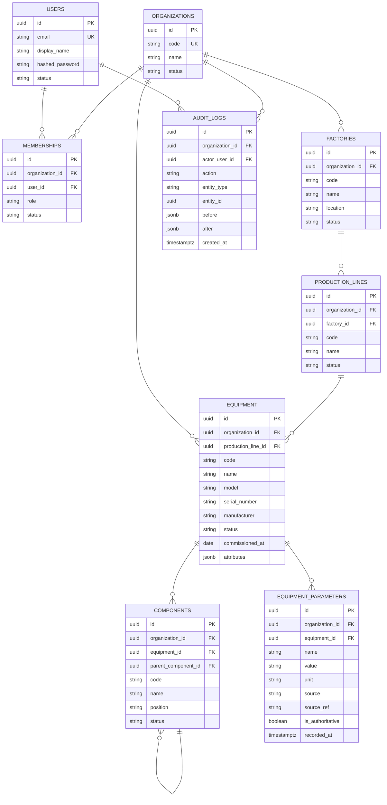

# ForgePilot 数据模型：ER 图与字段字典

## 通用约定

- 表名、列名 `snake_case`，表名复数；主键统一 `id uuid`。
- 所有表带审计列：`created_at`、`updated_at`（`timestamptz`，NOT NULL，DEFAULT `now()`）；业务表另带 `created_by`、`updated_by`（`uuid`，FK → `users(id)`，ON DELETE SET NULL）。
- 所有业务表带 `organization_id`（租户隔离键），唯一约束均以 `organization_id` 为前缀。

## 枚举

| 枚举                | 取值                                                                        |
| ------------------- | --------------------------------------------------------------------------- |
| `membership_role`   | `owner`, `admin`, `manager`, `technician`, `viewer`                         |
| `membership_status` | `invited`, `active`, `disabled`                                             |
| `equipment_status`  | `in_service`, `idle`, `maintenance`, `retired`                              |
| `parameter_source`  | `nameplate`, `manual`, `sensor`, `imported`, `model_inference`, `corrected` |
| `record_status`     | `active`, `archived`                                                        |

## ER 图

## 字段字典

### organizations（企业 / 租户）

| 列名     | 类型           | 约束                                     | 说明     |
| -------- | -------------- | ---------------------------------------- | -------- |
| `id`     | `uuid`         | PK                                       | 主键     |
| `code`   | `varchar(64)`  | NOT NULL, UNIQUE                         | 企业代码 |
| `name`   | `varchar(200)` | NOT NULL                                 | 企业名称 |
| `status` | `varchar(20)`  | NOT NULL, CHECK in (`active`,`disabled`) | 状态     |

### users（用户）

| 列名              | 类型           | 约束                                     | 说明     |
| ----------------- | -------------- | ---------------------------------------- | -------- |
| `id`              | `uuid`         | PK                                       | 主键     |
| `email`           | `varchar(255)` | NOT NULL, UNIQUE                         | 登录邮箱 |
| `display_name`    | `varchar(100)` | NOT NULL                                 | 显示名   |
| `hashed_password` | `varchar(255)` | NOT NULL                                 | 密码哈希 |
| `status`          | `varchar(20)`  | NOT NULL, CHECK in (`active`,`disabled`) | 状态     |
| `last_login_at`   | `timestamptz`  | NULL                                     | 最近登录 |

### memberships（用户 ↔ 企业）

| 列名              | 类型                | 约束                                                 | 说明     |
| ----------------- | ------------------- | ---------------------------------------------------- | -------- |
| `id`              | `uuid`              | PK                                                   | 主键     |
| `organization_id` | `uuid`              | NOT NULL, FK →`organizations(id)` ON DELETE CASCADE | 企业     |
| `user_id`         | `uuid`              | NOT NULL, FK →`users(id)` ON DELETE CASCADE         | 用户     |
| `role`            | `membership_role`   | NOT NULL                                             | 角色     |
| `status`          | `membership_status` | NOT NULL                                             | 成员状态 |

约束：`UNIQUE (organization_id, user_id)`。

### factories（工厂）

| 列名              | 类型            | 约束                                                  | 说明       |
| ----------------- | --------------- | ----------------------------------------------------- | ---------- |
| `id`              | `uuid`          | PK                                                    | 主键       |
| `organization_id` | `uuid`          | NOT NULL, FK →`organizations(id)` ON DELETE RESTRICT | 租户隔离键 |
| `code`            | `varchar(64)`   | NOT NULL                                              | 工厂代码   |
| `name`            | `varchar(200)`  | NOT NULL                                              | 工厂名称   |
| `location`        | `varchar(255)`  | NULL                                                  | 位置       |
| `status`          | `record_status` | NOT NULL                                              | 状态       |

约束：`UNIQUE (organization_id, code)`。

### production_lines（产线）

| 列名              | 类型            | 约束                                                  | 说明       |
| ----------------- | --------------- | ----------------------------------------------------- | ---------- |
| `id`              | `uuid`          | PK                                                    | 主键       |
| `organization_id` | `uuid`          | NOT NULL, FK →`organizations(id)` ON DELETE RESTRICT | 租户隔离键 |
| `factory_id`      | `uuid`          | NOT NULL, FK →`factories(id)` ON DELETE RESTRICT     | 所属工厂   |
| `code`            | `varchar(64)`   | NOT NULL                                              | 产线代码   |
| `name`            | `varchar(200)`  | NOT NULL                                              | 产线名称   |
| `status`          | `record_status` | NOT NULL                                              | 状态       |

约束：`UNIQUE (factory_id, code)`。

### equipment（设备）

| 列名                 | 类型               | 约束                                                  | 说明               |
| -------------------- | ------------------ | ----------------------------------------------------- | ------------------ |
| `id`                 | `uuid`             | PK                                                    | 主键               |
| `organization_id`    | `uuid`             | NOT NULL, FK →`organizations(id)` ON DELETE RESTRICT | 租户隔离键         |
| `production_line_id` | `uuid`             | NULL, FK →`production_lines(id)` ON DELETE SET NULL  | 所在产线           |
| `code`               | `varchar(64)`      | NOT NULL                                              | 设备编号（二维码） |
| `name`               | `varchar(200)`     | NOT NULL                                              | 设备名称           |
| `model`              | `varchar(120)`     | NULL                                                  | 型号               |
| `serial_number`      | `varchar(120)`     | NULL                                                  | 序列号             |
| `manufacturer`       | `varchar(200)`     | NULL                                                  | 制造商             |
| `status`             | `equipment_status` | NOT NULL                                              | 设备状态           |
| `commissioned_at`    | `date`             | NULL                                                  | 投运日期           |
| `attributes`         | `jsonb`            | DEFAULT`'{}'`                                         | 非关键扩展属性     |

约束：`UNIQUE (organization_id, code)`；`UNIQUE (organization_id, serial_number)`（忽略 NULL）。

### components（部件）

| 列名                  | 类型            | 约束                                                  | 说明               |
| --------------------- | --------------- | ----------------------------------------------------- | ------------------ |
| `id`                  | `uuid`          | PK                                                    | 主键               |
| `organization_id`     | `uuid`          | NOT NULL, FK →`organizations(id)` ON DELETE RESTRICT | 租户隔离键         |
| `equipment_id`        | `uuid`          | NOT NULL, FK →`equipment(id)` ON DELETE CASCADE      | 所属设备           |
| `parent_component_id` | `uuid`          | NULL, FK →`components(id)` ON DELETE CASCADE         | 上级部件（自引用） |
| `code`                | `varchar(64)`   | NOT NULL                                              | 部件编号           |
| `name`                | `varchar(200)`  | NOT NULL                                              | 部件名称           |
| `position`            | `varchar(120)`  | NULL                                                  | 安装位置           |
| `status`              | `record_status` | NOT NULL                                              | 状态               |

约束：`UNIQUE (equipment_id, code)`。

### equipment_parameters（设备参数）

| 列名               | 类型               | 约束                                                  | 说明                                        |
| ------------------ | ------------------ | ----------------------------------------------------- | ------------------------------------------- |
| `id`               | `uuid`             | PK                                                    | 主键                                        |
| `organization_id`  | `uuid`             | NOT NULL, FK →`organizations(id)` ON DELETE RESTRICT | 租户隔离键                                  |
| `equipment_id`     | `uuid`             | NOT NULL, FK →`equipment(id)` ON DELETE CASCADE      | 所属设备                                    |
| `name`             | `varchar(120)`     | NOT NULL                                              | 参数名                                      |
| `value`            | `varchar(120)`     | NOT NULL                                              | 参数值                                      |
| `unit`             | `varchar(32)`      | NULL                                                  | 单位                                        |
| `source`           | `parameter_source` | NOT NULL                                              | 参数来源                                    |
| `source_ref`       | `varchar(255)`     | NULL                                                  | 来源引用（文档+页码 / 传感器点号 / 工单号） |
| `is_authoritative` | `boolean`          | NOT NULL, DEFAULT`false`                              | 是否权威值                                  |
| `recorded_at`      | `timestamptz`      | NOT NULL                                              | 取值生效时间                                |

约束：`UNIQUE (equipment_id, name, recorded_at)`；`CHECK (source <> 'model_inference' OR is_authoritative = false)`。

### audit_logs（审计日志）

| 列名              | 类型          | 约束                                                  | 说明                       |
| ----------------- | ------------- | ----------------------------------------------------- | -------------------------- |
| `id`              | `uuid`        | PK                                                    | 主键                       |
| `organization_id` | `uuid`        | NOT NULL, FK →`organizations(id)` ON DELETE RESTRICT | 租户                       |
| `actor_user_id`   | `uuid`        | NULL, FK →`users(id)` ON DELETE SET NULL             | 操作人                     |
| `action`          | `varchar(64)` | NOT NULL                                              | 动作，如`equipment.create` |
| `entity_type`     | `varchar(64)` | NOT NULL                                              | 实体类型                   |
| `entity_id`       | `uuid`        | NULL                                                  | 实体主键                   |
| `before`          | `jsonb`       | NULL                                                  | 变更前                     |
| `after`           | `jsonb`       | NULL                                                  | 变更后                     |
| `created_at`      | `timestamptz` | NOT NULL                                              | 记录时间（只追加）         |
